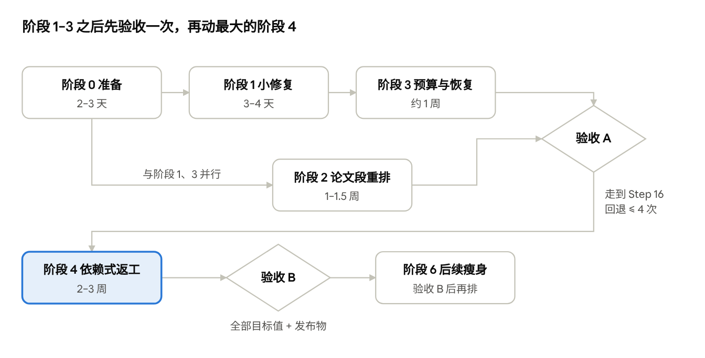

# Paper Factory 下一步优化执行方案

2026-11-05 · tfisher

> 本地副本。在线版本：<https://claude.ai/artifact/TT5gYhuZbN5X52XnmcXaeN>（以在线版为准，两边不会自动同步）。

目标是让一次无人值守的运行，用单一模型线路从 Step 0 走到 Step 16 并通过最终审计。路线是先修小而确定的缺陷，再从结构上去掉回退死循环，最后才做加固和瘦身。基线为 origin/main `8e8f872`，全程预计 6–8 周。

## 目标与成功指标

成功的标志只有一个：一次干净的验收运行，不靠人工改状态、不靠放行授权，完成交付。下表的现状来自 16 次新引擎运行的事件流（8 月 3 日至 10 月 16 日），目标值是建议值，可以调整。

| 指标 | 现状（16 次运行合计） | 目标（单次验收运行） |
| --- | --- | --- |
| 无人值守完成 | 0 / 16 | 完成 1 次 |
| 最终保留的模型工作占挂钟时间 | 7.4%（23.5h / 317h） | ≥ 40% |
| 语义回退 | 49 次，回到原位共 166h | ≤ 2 次 |
| 人工干预事件 | run4 30 个，gpt_formal 25 个 | 0（Step 3 选方法、Gate 2 除外） |
| 等人空转 | 184h（58%） | 只出现在设计好的决策点 |
| 基础设施故障消耗的内容尝试次数 | Step 10 一次烧掉 5 次、约 2h | 0 |
| 直接改数据库 | run2 一次，事件链从 rev 437 断开 | 0 |

## 依据

运行失败不是单个 bug，而是五类原因叠加；方案的每个阶段对应其中一到两类。

| 根因 | 关键证据 | 对应阶段 |
| --- | --- | --- |
| 返工按"文件归谁"判断，不按"什么真的依赖它" | 49 次回退；Step 12→Stage 3 有 12 次（66.8h），Step 5→Stage 3 有 11 次（72.6h）；改 `symbol_table.md` 也会重跑求解和灵敏度 | 2、4 |
| 把"无法判断"当成"不合格"，原因被错误归类 | Step 13 "verdict missing" 20 次；检查脚本崩溃烧掉 Step 10 全部 5 次尝试；余额不足被报成 codex 127 | 1 |
| 只会拒绝，不会恢复 | 空转 184h；约 25 种一次性 `USER_AUTHORIZED_*` 事件；77 个手写修复脚本；run2 被迫直接改库 | 1、3 |
| 外部依赖没当成一等约束 | DeepSeek 余额两次 402；`/tmp` 写满；canary4 在停机期间被比赛时钟耗尽 | 0、3 |
| 投入偏向加固，从未检验"能否走完" | 8 月以来 main 上 61 个提交改 `factory_core/`，18 个改 prompt 与指南；没有任何活性测试 | 0、5 |

分析数据与脚本：`runs_extract.json`、`reopens.txt`、`extract.py`（本机 scratchpad 目录，未进仓库）。

## 阶段 0：准备（约 2–3 天）

先建一个能衡量"能不能走完"的回归门禁，否则后面每一阶段都无法证明自己有效。

**0.1 决策回放测试台**

- 从 16 个 `state.db` 里抽取紧凑夹具：每次回退的变更文件集合（`dirty_causes`）、每次失败的分类与原因、每次尝试的起止时间。只含路径和分类，不含论文内容。
- 夹具放 `tests/fixtures/run_history/`，脚本放 `scripts/replay_run_history.py`。
- 回放的是**决策**，不重跑模型：把记录下来的变更集合和失败记录交给新规则，统计它会触发多少次回退、把哪些失败归为"无法评估"。
- run2 的事件链从 rev 437 起断开，只用到 rev 436；fable_pro 与 gpt_formal 完整可用。
- 产出一份基线报告：按当前 main 的规则重现 49 次回退和各类失败。之后每个阶段合并前都要跑一遍，对比基线。

**0.2 运行环境**

- 运行脚本统一把 `TMPDIR` 指向磁盘（`/tmp` 是 3.9G tmpfs，曾被测试残留占满）。
- 写一个模型线路预检命令：探测余额、配额和连通性，开跑前和每个 Step 前各调用一次。
- `~/pf-acceptance` 工作区还留着一行本地 `engine.py` 豁免补丁：验收前重建一个干净的验收主机，而不是在它上面继续。

**0.3 先处理的遗留事项**

- [ ] 决定 `chore/retire-dead-assets-batch1` 上 5 个未进 main 的清理提交去留
- [ ] 决定 `~/.codex` 下约 3G 旧运行日志去留
- [ ] MCP 分支保持只在本地，不并入本方案的任何分支
- [ ] 本地 `main` 已快进到 `8e8f872`，本方案所有分支从它切出

**退出条件**：回放脚本能在 CI 里跑，并且重现当前基线；预检命令能对 402 快速报错。

## 阶段 1：小而确定的修复（约 3–4 天）

五项改动都局限在单个函数或配置，不需要产品决策，可以各自单独提 PR。位置均已在 `8e8f872` 上核对。

| 编号 | 改什么 | 位置 | 验收 |
| --- | --- | --- | --- |
| 1a 三值检查 | 检查脚本没产出结论就退出（traceback、磁盘满、子进程内异常）时，归为"无法评估"，不再当内容失败，不消耗内容尝试次数 | `factory_core/audit/incremental.py` `_command_checks`（第 470–501 行） | 崩溃脚本夹具；回放中 Step 10 的 5 次失败归为无法评估 |
| 1b 失败原因聚合 | 失败记录增加 `attempts` 列表，写入每个候选模型的 backend、错误类和摘要；主错误类取最能解释问题的一项（余额不足优先于文件不存在） | `factory_core/adapters/models/dispatcher.py` `execute`（候选循环第 83 行） | 三个候选依次失败时，事件里能看到 402 |
| 1c pause 真停 | 把"能否停进程"和"能否提交结果"拆开；确认不了进程身份时拒绝 pause，不提交和进程树矛盾的状态。REV3 已查明根因是 `aggregate_valid=False` 导致身份解析失败 | `factory_core/service.py` `_recorded_runner_identity` / `_verify_runner_stop`（第 1424–1456 行） | pause 后 runner 进程确实退出，或 pause 被拒绝并说明原因 |
| 1d Step 0 尝试次数 | `max_attempts` 从 1 改为 3，瞬时后端错误不计次 | `factory_core/steps/catalog.py` Step 0 合同 | canary 1 的场景不再卡死 |
| 1e 误分类 | "reviewer-entry gate is not ready" 不再标成 `TRANSIENT_MODEL_BACKEND` | 引擎里 8.5 门禁的失败分类处 | 回放中 5 次该类失败归类正确 |

**退出条件**：相关单测通过；`uv run pytest -q -m "not latex"` 全绿；回放报告中"基础设施故障消耗内容尝试"归零。

## 阶段 2：论文段重排（约 1–1.5 周，需要改 STEPS.md 与 prompt）

这一阶段用调整顺序来消除 F-C、F-D 两个死循环，并把论文的 Judge 从两轮变成一轮。Step 编号保持不变，只改执行顺序和归属的 Stage，以免牵动 Web、数据库和 prompt 里的大量引用。

| 项 | 现在 | 改后 |
| --- | --- | --- |
| 执行顺序 | 9 → 10 → 11 → 12 → 13 预审 → 14 摘要 → 15 润色 → 16 最终审计 | 9 → 10 → 11 → 12 → 14 → 15 → 13 Judge → 16 交付 |
| Judge 次数 | 2 轮：Step 13 的预审按设计在 14、15 改稿后作废 | 1 轮：Step 13 审的就是最终文本；Step 16 的最终审计在快照指纹未变时直接复用它的判定 |
| 8.5 门禁 | 每次选择任务都重算输入指纹，一变就退回 Step 8 | 只在 Step 9 开始前校验一次；Step 9 之后改这些报告不再让它失效 |
| 摘要、润色改 `paper.tex` | 行内公式算 Stage 8 的数学指纹，退回 Step 10 之后 | 不产生上游义务；数字与公式由之后的 Judge 和 `verify_numbers` 把关 |
| 修订改文档 | 改 `symbol_table.md`、`model.md` 退回 Stage 3 | 纯文档修改不回退；改模型代码仍按现规则处理，留到阶段 4 |

**具体改动**

1. `factory_core/stages.py`：把 Step 13 移到 14、15 之后（整理为 Stage 8 评审与修订、Stage 9 摘要与润色、Stage 10 Judge 与交付），同步 `contest.py` 的阶段映射。
2. `factory_core/engine.py` 第 1044–1069 行（`reviewer_current` 与 "reviewer-entry fingerprint changed"）：改成只在 Step 9 入口校验。
3. 在版本化扩展层 `factory_core/current_dirty.py` / `artifact_policy.py` 加策略条目（与 `8e8f872` 对 `scripts/submit_*.sh` 的做法相同），不改冻结的 `dirty.py`。
4. Step 16 的最终审计复用 Step 13 的判定：按快照指纹命中审计缓存，未命中才重跑。（原计划"Gate 2 位置不变"已被决策 2 取代：Gate 2 放在 Step 13 之前，执行顺序为 12 → 14 → 15 → Gate 2 → 13 → 16，见阶段 2 执行记录。）
5. 更新 `STEPS.md`、`prompts/step14_abstract.txt`、`step15_polish.txt`、Judge 的 prompt，以及前端的步骤展示与 `tests/step-display.test.mjs`。

**退出条件**：回放中 F-C、F-D 两类回退和纯文档引起的回退归零；前端测试与核心测试全绿；CHANGELOG 记录合同变更。

备选方案：直接去掉 Step 13 预审，只保留 Step 16 的最终 Judge。改动更小，但数学问题会在交付步才暴露，只剩 1 次修复机会。

## 阶段 3：预算、恢复入口与资源预检（约 1 周，可与阶段 2 并行）

以后每一种"拒绝"都要配一条正式的恢复路径，让人工改数据库和一次性的 `USER_AUTHORIZED_*` 事件不再有必要。

| 编号 | 改什么 | 位置 |
| --- | --- | --- |
| 3a 运行级回退上限 | 保留"每个发起阶段 2 次"，另加"每次运行共 5 次"（决策 4）。任一用尽时进入 `PAUSED` 并生成一份说明：哪些文件、哪次回退、建议怎么处理。不再直接判为永久失败 | `engine.py` `_stage_semantic_reopen_allowed`（第 1672 行）及第 1452–1474 行 |
| 3b 正式的重试入口 | 新增 `factory action retry-step <project> --step N --expected-revision R --reason …`，写一条通用事件并重置该 Step 的尝试次数。替代直接改库和各种一次性事件类型 | `service.py`、`cli.py`、`workflow_events.py` |
| 3c 只有"发现缺陷"才计次 | 尝试次数只在检查结论为"发现缺陷"时增加；"无法评估"与后端不可用只重试基础设施 | `engine.py` 第 467–479 行的预算判断 |
| 3d 开跑前资源预检 | 每个 Step 派发前检查模型线路余额、配额和磁盘空间；不足则以 `PROVIDER_UNAVAILABLE` 暂停，不消耗尝试次数 | 引擎派发前 + 阶段 0 的预检命令 |
| 3e 比赛时钟 | 真实比赛的截止时间无法暂停，所以保留现有语义，靠 3d 提前发现外部问题；状态里分开显示"工作时间"与"等待外部依赖时间" | `contest.py` `effective_timeout`（第 92 行）与 Web 比赛看板 |

**退出条件**：回放中 `PERMANENT_STAGE_SEMANTIC_REOPEN_EXHAUSTED`、`PERMANENT_ATTEMPT_BUDGET_EXHAUSTED` 都变成可恢复的暂停；一次模拟的 402 在第一次模型调用前就被拦下。

## 阶段 4：按输入依赖替换返工判定（约 2–3 周，最大的一项）

新规则：只有"计算输入"（模型代码、数据、规范化结果）变了，才重跑消费它的计算步骤；文档类变更一律向前修复，交给后面的数字核对和 Judge 把关。这样去掉的是"按归属回退"这条规则本身，而不是再打一个补丁。

**规则**

1. 每个 Step 在合同里声明自己**消费**的关键输入，分为"计算输入"和"文档输入"两类。
2. Step 通过时，检查点记录它消费的计算输入的哈希。
3. 任一后续 Step 改了某个计算输入：只重跑已完成且消费它的计算步骤（通常是 5→6→7→8 这一串），然后回到原来的 Step 继续。不再重做 Step 4 建模。
4. 改了文档输入：不重跑任何已完成的 Step。
5. 去掉按归属选取回退目标的逻辑（`engine.py` 第 1434–1497 行）和每阶段的回退预算。

**各 Step 的输入清单（初稿，实施前要对照 STEPS.md 逐条确认）**

| Step | 计算输入 | 文档输入 |
| --- | --- | --- |
| 4 建模 | `data/final/**`、`problem/problem_plan.json` | `chosen_method.md`、`problem/*.md` |
| 5 求解 | `models/**` 代码、`data/final/**` | `model.md` |
| 6 灵敏度 | `models/**` 代码、`results/canonical_results.json` | — |
| 7 评价 | `results/canonical_results.json`、`results/sensitivity/**` | `sensitivity_report.md` |
| 8 可视化 | `results/**` | `evaluation.md` |
| 9–15 论文段 | `results/canonical_results.json`、`figures/**` | `model.md`、`symbol_table.md`、各报告 |
| 13 Judge、16 交付 | 全部交付物（快照指纹） | — |

**实施约束**

- 只在版本化扩展层实现（REV3 的 W8 结论），不改冻结的 `dirty.py` 与 v1 信任根。
- 新规则只对新项目生效；已有项目保持原分类器。
- `artifact_ownership.py` 保留：它还服务于 finalization、submission bundle 和 cleanup，只是不再用来决定回退。
- 把 solver 对账（S5）的"结果是否由登记作业产生"接入"计算输入变化"的判断，结果文件的来源不再只靠文件归属。

**退出条件**：回放 49 次记录在案的回退，新规则只对"计算输入确实变了"的那部分触发重跑，并逐条列出理由；单测覆盖文档修改、代码修改、结果修改三种情形。

## 阶段 5：两次验收运行

验收分两次跑：第一次在阶段 1–3 之后，尽早拿到收益证据；第二次在阶段 4 之后，按真实比赛条件跑。两次都用 2026 A 题，和 canary4、run2 可比。

| 项 | 验收 A（阶段 1–3 后） | 验收 B（阶段 4 后） |
| --- | --- | --- |
| 代码 | 干净的 main，新建验收主机，工作区无本地改动 | 同左 |
| 比赛时钟 | 延长到 7 天，只看能否走完 | 默认 74 小时 |
| 模型线路 | 单一线路，全程不切换 | 同左 |
| 余额 | 按 4–6h 模型工作加余量充足（上一次充值只够 2–3h） | 同左 |
| 允许的人工操作 | Step 3 选方法、Gate 2、阶段 3 的正式恢复命令 | Step 3、Gate 2 |
| 禁止 | 直接改库、放行授权、临时补丁、中途换模型 | 同左 |
| 通过标准 | 走到 Step 16；回退 ≤ 4；基础设施故障不消耗内容尝试 | 达到"目标与成功指标"全部目标值，并产出发布物 |

未通过时，用与上一轮相同的提取脚本生成时间账和失败分类，归到对应阶段修复后重跑，不在运行中途打补丁。

## 阶段 6：后续瘦身（验收 B 通过后再排）

这些项不是运行失败的主因，但会持续增加维护成本和新的拒绝点。每项动手前先做一次调用面盘点，确认 Web 和其它消费方。

| 项 | 内容 | 规模 | 风险 |
| --- | --- | --- | --- |
| 身份绑定瘦身 | 检查点有效性只绑定输入与输出哈希；prompt、模型配置只进日志。换模型配置不再让检查点失效（F-E）。涉及 `effective_prompt.py` `model_config_identity`、`prompt_receipts.py` | 中 | 低 |
| 存储层 | 保留 append-only 事件、快照和 revision CAS；去掉按域的 effect-hash 链与重放一致性门禁；历史项目只读归档，不再写旧版本迁移。`storage.py` 等约 6000 行 | 大 | 中，失去篡改检测，需要你决定 |
| 操作层收缩 | bounded run 合同（931 行）、手写驱动检查器、验收主机的 supervisor 收缩为 `run` / `pause` / `stop` | 中 | 低，前提是引擎已能无人值守跑完 |
| 坐标统一 | 17 个 Step（另有 8.5）、10 个 Stage、subtask/source_step、Web 的 8 个比赛阶段合并为一条线性任务列表 | 大 | 高，放最后 |
| 兼容投影 | `run_paper.sh` 适配器、`checkpoint.md`、扁平 `papers/` 别名等，确认无消费方后删除 | 小 | 低 |
| solver 对账闸（S5） | 只拦新的完成，已完成项目由 `audit` 报告；先修好作业长期停在 running 的问题（F7），再接闸，否则会变成新的死锁 | 中 | 中 |
| 外围功能 | 咨询窗口、联合建模、云求解、MCP、TUI：冻结，不加新功能 | — | — |

## 需要你拍板的决策

第 1、2 项挂在关键路径上，阶段 2 开工前需要定下来；第 3 项在阶段 4 开工前定。

| # | 决策 | 我的建议 | 最晚何时 |
| --- | --- | --- | --- |
| 1 | 是否允许修改 `STEPS.md` 与 prompt（项目规定这些是 agent 合同，不能随意改） | 已定（11 月 6 日）：允许，逐条写进 CHANGELOG | 阶段 2 开工前 |
| 2 | 论文段采用"重排到 14→15→13"还是"直接去掉 Step 13 预审" | 已定（11 月 6 日）：重排；Gate 2 放在 Step 13 之前（见阶段 2 执行记录） | 阶段 2 开工前 |
| 3 | 新的返工规则只用于新项目，还是也迁移现有项目 | 已定（11 月 7 日）：只用于新项目 | 阶段 4 开工前 |
| 4 | 运行级回退上限的数值，用尽时暂停还是失败 | 已定（11 月 6 日）：每个发起阶段 2 次 + 每次运行 5 次，任一用尽都暂停并报告（见阶段 3 执行记录） | 阶段 3 |
| 5 | 验收运行的模型线路与充值金额 | 需要你定；至少覆盖 6h 模型工作 | 验收 A 前 |
| 6 | 存储层是否放弃按域哈希链 | 验收 B 后再定 | 阶段 6 |
| 7 | REV3 修复计划怎么处理 | 作为参考：它的 W1b、W3、W4、W8 并入本方案阶段 1–4，W0 写入屏障类推迟到阶段 6 | 阶段 0 |
| 8 | `chore/retire-dead-assets-batch1` 的 5 个提交 | 重新基于 main 提 PR 合入，或放弃 | 阶段 0 |
| 9 | `~/.codex` 下约 3G 旧运行日志 | 打包进已有备份目录后删除 | 任意 |
| 10 | "只用于新项目"如何绑定 | 已定（11 月 7 日）：绑定 Stage catalog v2（不改 schema；现有项目都不是 v2） | 阶段 4 |
| 11 | Step 4 是否算计算步骤 | 已定（11 月 7 日）：不算，数据变化只重跑 5–8 | 阶段 4 |

## 风险与不做的事

最大的风险是放松回退后，该重算的东西没有重算；对策是让数字核对和唯一一次 Judge 留在最后把关。

| 风险 | 对策 |
| --- | --- |
| 输入清单漏了某个计算输入，结果过时却没重跑 | `verify_numbers` 与最终 Judge 仍在交付前把关；回放报告逐条列出"不重跑"的理由供审查 |
| 改 `STEPS.md` 与 prompt 后模型行为变化 | 验收 A 专门检验；保留旧 prompt 以便对照 |
| 与 REV3 计划、已合并的 bounded run 工作冲突 | 决策 7 先定调；每个 PR 说明取代了 REV3 的哪一项 |
| 新引擎只对新项目生效，两套规则并存 | 历史项目只读归档，不再继续推进 |
| 模型供应商余额、限流 | 阶段 3 的预检；验收前充足余额 |

**不做的事**

- 不加新的加固层，除非某个失败只能这样解决
- 不做新功能：咨询、联合建模、云求解、TUI 都冻结
- MCP 分支不推到 GitHub
- 不在验收运行中途打补丁、改库或发放行授权

## 排期总览

阶段 0 之后，阶段 1→3 与阶段 2 两条线并行，全部完成后跑验收 A；验收 A 通过再做阶段 4，然后跑验收 B。各阶段工期是粗估，合计约 6–8 周，不含验收运行本身的 2–3 天挂钟时间。

## 阶段 0 执行记录（2026-11-05，分支 `feat/liveness-phase0`，基于 `8e8f872`）

**0.1 决策回放测试台：完成。**

- `scripts/extract_run_history.py`：只读、immutable 打开 `state.db`，抽取事件、每次提交的分类变更集合（`dirty_causes`）与 solver 作业归属；丢弃哈希链、prompt 收据与证据摘要，家目录替换为 `~`，疑似密钥替换为 `<redacted>`。
- `tests/fixtures/run_history/`：16 次运行的夹具（1.8 MB）、`labels.json`（67 条有出处的失败原因）、`_baseline_8e8f872.json`（基线摘要）。
- `scripts/replay_run_history.py`：时间账、按可替换规则重判每个变更集合、非内容原因的尝试损失。`current` 规则直接调用 main 的 `current_dirty.classify_manifest_changes` 与 `resume_after_step_for_stage`。
- `tests/test_run_history_replay.py`（11 例）：夹具无密钥与家目录；回放忠实性；时间账与记录判定不漂移；回退判定与非内容尝试损失不得高于基线。

**基线（当前 main 规则）**

| 指标 | 值 |
| --- | --- |
| 挂钟时间 / 保留的模型工作 | 316.9 h / 23.5 h（7.4%） |
| 空转 | 184.6 h |
| 变更集合：记录 / 参与判定（提交路径） | 346 / 299 |
| 回退：记录 / 当前规则判定 | 49 / 46 |
| 当前规则下最大的两类回退 | Stage 8→3：12 次；Stage 4→3：11 次 |
| 非内容原因消耗尝试 | 54 次（5.4 h） |

结论：`8e8f872` 的修复只让历史上的回退从 49 次降到 46 次；阶段 2、4 针对的两类回退在当前 main 上仍然存在。

**与计划的差异**

- `dirty_causes` 记录的是每一次提交的完整变更集合，而不只是回退那几次，所以回放覆盖了 299 个判定，而不是 49 个。
- run2 的事件链在 rev 437 因人工改库断开，但其后的判定（包括 F-C、F-D 两类回退）都真实发生过，因此保留全部事件用于决策回放，而不是只用到 rev 436。
- 忠实性：当前分类器下记录的 47 个提交变更集合中有 46 个逐条复现；唯一差异 run2 rev 774 来自验收主机上的本地豁免补丁（10-16 12:48Z 生效），测试中作为已知例外登记。
- 引擎只在提交路径上判定回退；失败尝试的变更集合只记录，不参与判定。最初没区分时会多判 24 次。

**0.2 运行环境：代码部分完成。**

- `factory_core/runtime_env.py`：继承的临时目录在 tmpfs/ramfs 上时，把 `TMPDIR` 指向 `run_state/tmp`（`FACTORY_TMPDIR` 可覆盖）。用在 worker 启动环境，以及 `run`、`worker`、`advance` 与兼容入口执行期间。
- `factory preflight`：只读路线预检，候选链与调度器一致；402、余额不可用、凭据缺失、DSH 的 Node 版本过低都判 FAIL，且从不输出凭据。测试覆盖了"模拟 402 时退出码为 3"。
- 未做：真实网络下的预检（需要先用 `scripts/load_secrets.sh` 加载生产密钥，由操作员执行）；重建干净的验收主机（放到验收 A 之前，`~/pf-acceptance` 作为证据保留不动）。
- 已知局限：预检按 Step 级候选链检查，不覆盖 Step 13 Judge 各角色单独的模型分配。

**0.3 遗留事项：待决定。**

`chore/retire-dead-assets-batch1` 的 5 个提交、`~/.codex` 下约 3G 日志，仍等待操作员决定。

**验证与顺带发现**

- 核心测试套件（CI 同款参数）：2698 passed、0 failed；driver guard、`compileall`、`git diff --check` 通过。本机需去掉 SOCKS 代理变量 `ALL_PROXY`，否则 TUI 测试因缺少 `socksio` 失败，与代码无关。
- 一轮完整测试会在 `TMPDIR` 下留下约 1.5–2 GB 临时目录，其中有一百多个 `paper-factory-*` 目录由被测代码 `mkdtemp` 创建后未清理，还有只读的"不可变产物"。在 3.9G 的 tmpfs `/tmp` 上连续跑三轮会写满 `/tmp`，导致 824 个测试以 `database or disk is full` 失败。这和验收 run2 Step 10 是同一故障模式。临时目录放进仓库内又会触发 3 个"必须在仓库外"的测试，所以本机跑套件时应把 `TMPDIR` 指到仓库外的磁盘目录，并在跑完后清理。测试的临时目录泄漏留待后续处理。

## 阶段 2 执行记录（2026-11-06，分支 `feat/phase2-paper-reorder`，基于 `ebb885e`）

**追加决策：Gate 2 放在 Step 13 之前。** 开工时核对代码发现，审计快照指纹（`scripts/submission_fingerprint.py`）包含人工批准凭证 `approval_receipts`，最终审计在 analysis 模式下也要求 content-freeze 已批准（`audit/service.py`）。因此"Judge 在批准前跑、Step 16 在指纹不变时复用"按现有代码不成立：批准一落，指纹就变。11 月 6 日定为 12 → 14 → 15 → Gate 2 → 13 → 16。批准与完整 Judge 的先后关系与 v1 相同（v1 也是先批准、Step 16 再跑 Judge），指纹与凭证结构不变；代价是批准时还看不到 Judge 结论。

**第一部分：引擎与审计（可选启用，默认仍为 v1）**

- 新阶段编排 `factory-stage-catalog-v2`（`factory_core/stages.py` 的 `StageCatalog`）：Stage 8 = 11、12；Stage 9 = 14、15；Stage 10 = content-freeze → `final_judge`（Step 13）→ 16。Step 编号含义不变。v2 里 Step 13 在 14、15 之后，所以一切"谁在谁之后"都按编排位置判断：检查点失效、`resume_after_step_for_stage`、初始化种子、回退目标校验、content-freeze 拒绝后的回退点。v1 的原函数逐字节保留，测试断言通用实现与之完全一致。
- 新项目默认仍是 v1；`factory create --stage-catalog v2` 或 `FactoryService.create_project(stage_catalog_version=...)` 显式启用。现有项目不迁移（与决策 3 的建议一致）。
- v2 的 Step 13 是一次完整的最终审计（analysis 模式：编译、论文检查、视觉门禁、三角色 Judge、判定凭证），以 execution Step 16 的身份运行，绑定已批准的快照，不写任何验收或交付产物。Step 16 只在编译前探测到同一快照、判定凭证校验通过的 analysis PASS 时，把它作为 Judge 结果交给原有验收收尾（判定路由、快照复核、凭证重建、交付边界、最终验收凭证），不重跑 Judge；快照一变就照常完整重跑。v1 的 Step 16 不启用这条路径。
- v2 的归属规则（`factory_core/stage_catalog_v2_policy.py`，并入 v2 的分类器身份，v1 身份不变）：`judge_evaluation.md` 与 Judge 阶段自己写的问题台账归 Stage 10；论文源文件的 MATH 域归 Stage 10（由 Judge 与 `verify_numbers` 把关）；Stage 7 起修改 `model.md`、`symbol_table.md`、`evaluation.md`、`sensitivity_report.md`、`visualization_log.md`、`reviewer_entry_map.md`、`anchor_figure_plan.md` 视为向前修复。模型代码、数据、规范化结果、求解收据与 `claim_registry.json` 仍按原规则回退。状态库清除脏标记时内嵌的分类器 rebase 也按同一规则处理 v2 项目。
- 8.5 门禁在 v2 里只在 Step 9 开始前校验；Stage 8 出口的"未解决 BLOCKING/MAJOR"检查移到 Step 12；v2 的 Step 13 和 Step 16 一样受比赛终点而非 content freeze 约束，也同样受 T−2h 交付冻结约束；v1 的 Step 13 技术续跑在 v2 不存在。

**回放（16 次运行，新增规则 `v2`）**

| 指标 | current | v2 |
| --- | --- | --- |
| 判定的回退 | 46 | 27 |
| Stage 9 → 8（摘要、润色改公式） | 6 | 0 |
| Stage 10 → 8（最终审计改写 Judge 投影） | 5 | 0 |
| Stage 10 → 8（v1 预审 agent 改 `revision_summary.md`，v2 的 Step 13 不写该文件） | — | 1 |
| Stage 10 → 3（Step 13 期间改了 `claim_registry.json`，按原规则回退） | — | 1 |
| Stage 8 → 3 / 6（修订只改文档） | 13 | 0 |
| Stage 8 → 3 / 4（修订改了模型代码或重跑求解，留给阶段 4） | — | 3 |
| Stage 10 → 9（Step 16 期间改了论文正文） | 2 | 2 |

回放行同时记录 `recorded_stage`（事件记录时的 v1 Stage）和 `evaluated_stage`（规则判定所在的 Stage），Stage 对统计一律用后者。早先版本的 v2 统计按记录 Stage 归类，把 Step 13 的两次回退算进了 Stage 8，上表已按判定 Stage 重新生成。

**验证**：核心套件 2797 passed；新增 `tests/test_stage_catalog_v2.py`（20 例）、`test_audit_service.py` 中 5 例提升测试、`test_run_history_replay.py` 中 1 例 v2 回放门禁。

**第二部分：合同、prompt、看板与前端（已完成；v2 显式试运行，默认仍为 v1）**

- `STEPS.md`、README、CLAUDE.md 写明 v2 合同，v1 合同保留并标注适用范围。
- prompt 模板不改：v1 渲染结果逐字节不变；v2 在渲染后按 `factory_core/steps/catalog_prompts.py` 整句改写 Step 12/14/15，原句缺失即报错。Judge prompt 不需改动。
- 比赛看板与前端按项目编排的位置判断步骤完成、下一步与所属阶段；v2 的 Step 13 归入"最终审计与交付"。
- 新项目默认仍为 v1，`--stage-catalog v2` 显式试运行；验收 A（v2 的第一次真实运行）通过后再切换默认值。现有项目不迁移。

阶段 2 的退出条件（回放中 F-C、F-D 与纯文档回退归零、前端与核心测试全绿、CHANGELOG 记录合同变更）已满足，有一处例外需要说明：按判定 Stage 重新统计后，v2 回放里仍有 1 次由文档引起的 Stage 10 → 8（`revision_summary.md`）。它来自历史上 v1 预审 agent 写该文件，v2 的 Step 13 是只读分析的最终审计，不写这个文件，回放门禁测试也断言了这一点；这次回退在 v2 里不会发生，但它不是规则消除的，而是行为不同。验收 A 将是 v2 的第一次真实运行。

## 阶段 3 执行记录（2026-11-06，分支 `feat/phase3-recovery`，基于 `bd197bc`）

决策 4（11 月 6 日）：保留"每个发起阶段 2 次"，另加"每次运行共 5 次"，任一用尽都暂停。依据是 v2 规则下的回放：只用"每次运行共 3 次"会让 16 次运行中的 4 次暂停，改成"每阶段 2 次 + 每次运行 5 次"约 3 次；按阶段的上限防同一处反复打转，总上限防多个阶段分散累积。

- **3a 回退上限**：两个上限都按当前分类器身份计数。用尽时写 `PAUSED`（subcode `SEMANTIC_REOPEN_BUDGET`），保留 Stage 游标，并记录 `reopen_budget` 说明（哪个上限、计数、待回退的上游文件、已发生的回退）。继续的两条正式路径：撤销上游改动后恢复（经 recovery 重新检查，不重跑模型）；或 `factory action grant-reopen --reason`（Web："批准一次回退"），记录 `SEMANTIC_REOPEN_GRANTED`，恰好多允许一次，每次暂停只能批准一次。
- **3b 重试入口**：`factory action retry-step <project> --step N --reason …`（Web："重试失败的步骤"）。只对 FAILED 且游标在该 Step 的项目生效，记录 `STEP_RETRY_AUTHORIZED` 并把尝试次数清零，下一次从第 1 次尝试重跑。替代历史上的 `FAILED_SUBTASK_RETRY_AUTHORIZED`、`TECHNICAL_FLOW_ATTEMPT_BUDGET_RESET` 与各种 `USER_AUTHORIZED_*` 重试事件。
- **3c 只有发现缺陷才计次**：七个 Judge 类别（`TRANSIENT_JUDGE_INDETERMINATE`、`_ROLE`、`_PACKET`、`_INFRASTRUCTURE`、`_PROVENANCE`、`_AGGREGATION`、`_ROUTING`，即 Judge 的判定没有产生或没有被路由出来）不再消耗内容尝试（`_ROUTING` 是审查修复中加入的；同时把决策路由给出的 `INFRA_RETRY` / `PACKET_REBUILD` 从永久失败改为可重试；`TRANSIENT_JUDGE_INCOMPLETE` 仍计次），改为重试基础设施，共用一份预算，用尽为 `PERMANENT_JUDGE_INFRASTRUCTURE`。基础设施预算改为按终止类计数。回放中"非内容原因消耗尝试"从阶段 3 起点 `bd197bc` 的 48 次（5.8 h）降到 20 次（4.5 h）（`8e8f872` 基线 `_baseline_8e8f872.json` 记为 56 次，阶段 1e 已降到 48 次）；剩余为后端不可用（3d 处理）、阶段 1a 之前的检查脚本崩溃、流程上限用尽（3a/3b 处理）。
- **3d 派发前资源预检**：引擎在 `STEP_STARTED` 之前对该 Step 的候选模型和临时空间做检查（复用阶段 0 的 `factory preflight`）。只有确定的 FAIL 才拦截（所有候选都不可用，例如 HTTP 402 余额不足；或空间低于 2 GiB），UNKNOWN/WARN 和检查本身出错都不拦。拦截时写 `PAUSED`（subcode `PROVIDER_UNAVAILABLE`），不消耗尝试次数，恢复后从第 1 次尝试派发。v2 的 `final_judge` 不在此检查（它的 Judge 按 Step 16 路由）。`FACTORY_DISPATCH_PREFLIGHT=0` 可关闭。
- **3e 比赛时钟**：截止时间语义不变；看板的 `timing.time_split` 把已用比赛时间分成工作、等人工、等外部服务、已停止四类。

**退出条件**：`PERMANENT_STAGE_SEMANTIC_REOPEN_EXHAUSTED` 改为可恢复的暂停（3a）；`PERMANENT_ATTEMPT_BUDGET_EXHAUSTED` 有正式的重试入口（3b）；模拟的 402 在第一次模型调用前被拦下（3d，`tests/test_dispatch_preflight.py`）。回放无法重新模拟暂停之后的历史，这些由引擎级测试覆盖。

## 阶段 4 执行记录（2026-11-07，分支 `feat/phase4-input-deps`，基于 `b7c2f4b`）

决策 3、10、11（11 月 7 日）：新规则只用于新项目，绑定 Stage catalog v2（现有项目都是 v1 或旧格式，没有 v2 项目）；Step 4 是建模创作，不算计算步骤，数据变化只重跑 5–8。

- **4a 合同与回放**：`factory_core/input_dependency_policy.py` 定义计算输入（代码、数据、主结果、灵敏度结果）及其消费者，消费者由所有权注册表的 owner Stage 推出；文档、机器证据（含 `bound.json`、`convergence.json` 等求解诊断）、本子任务新建的文件不触发重算；未登记的路径（`fallback`）与其他失败关闭记录保留按归属回退。回放规则 `v2-inputs` 与引擎走同一条链（当前分类器 → v2 归属规则 → 输入依赖规则）：49 次回退中 1 次重算（run2 rev490，修订改了求解代码与主结果，重跑 5–8），2 次为未登记文件的失败关闭回退（gpt_formal rev902、rev948），46 次向前修复，逐条理由见 `tests/test_run_history_replay.py` 的断言与回放 JSON 的 `reasons`。
- **4b 引擎**：v2 项目在 `_stage_manifest_delta` 中先套阶段 2 的 v2 归属规则，再套输入依赖规则；重算只删除计算子任务的检查点，调度器重跑后回到发起子任务（不重跑中间的论文步骤）。失败关闭类记录保留按归属回退。

与方案初稿的差异：
- **规则 1、2 未按初稿实现**：Step 合同里没有声明各自消费的计算输入，检查点也不记录这些输入的哈希。消费者改由所有权注册表的 owner Stage 推出（求解代码 → 5，灵敏度脚本 → 6，图脚本 → 8；主结果 → 6，灵敏度结果 → 7），"是否变化"沿用子任务基线清单的指纹比较。退出条件按这一实现验证，不是按初稿的合同声明验证。
- **Step 4 的输入**：初稿把 `data/final/**`、`problem_plan.json` 列为 Step 4 的计算输入；按决策 3，Step 4 不再因此重跑。
- **回退预算保留**：初稿第 5 条要求去掉每阶段的回退预算。实现中保留阶段 3 的两级预算（每发起阶段 2 次、每次运行 5 次）并对重算计数，作为防止循环的安全阀；回放中重算只有 3 次，不会触顶。
- **求解作业回执**：消费者目前按所有权注册表推出。用求解作业回执（作业实际运行的脚本与输入）进一步收窄，留作后续：回放夹具不含逐作业输入，无法验证。

**退出条件**：回放 49 次回退，新规则只对"计算输入确实变了"的 1 次触发重算并逐条列出理由（另 2 次为未登记文件的失败关闭回退）；单测覆盖文档修改、代码修改、结果修改（另有新文件、证据、同 Stage 消费者、v1 对照）。

尚未处理：比赛看板在重算期间的剩余步数估计按当前子任务之后的位置计数，会把已保留检查点的论文步骤算进去（高估约 3 步）；验收 A 将是这条规则的第一次真实运行。
